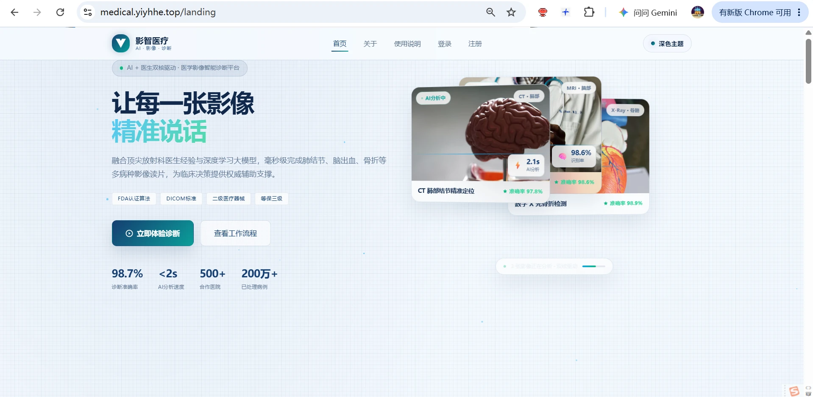
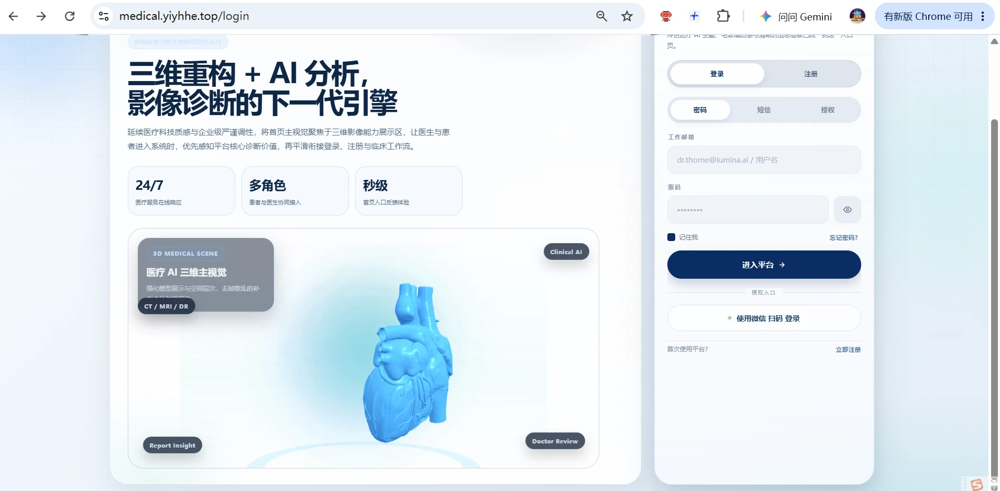
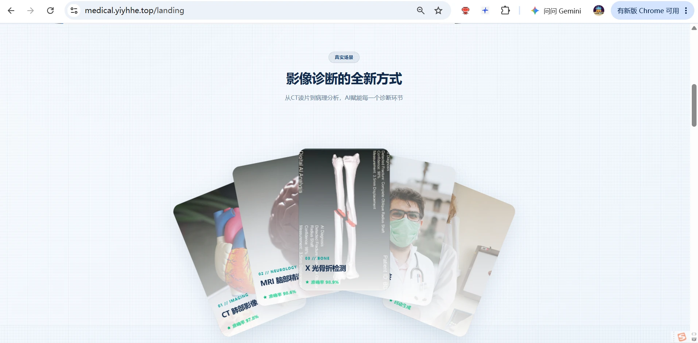

<div align="center">

# 影智医疗 · Aipoinners

**AI + 医生双核驱动的医学影像智能诊断平台**

从影像上传、AI 分析、报告生成，到在线问诊、医生诊断与智能问答，覆盖「患者 — 医生 — 平台」的完整业务闭环。

[](https://openjdk.org/)
[](https://spring.io/projects/spring-boot)
[](https://spring.io/projects/spring-cloud)
[](https://vuejs.org/)
[](https://pytorch.org/)
[](https://www.mysql.com/)

在线演示：<https://medical.yiyhe.top>

</div>



---

## 📖 项目简介

**Aipoinners（影智医疗）** 是一套面向医院与患者的一体化医学影像 AI 诊断平台，采用 **Java 微服务 + Python 推理服务 + Vue 3 前端** 的混合架构：

- **患者端** —— 上传 CT / MRI / X-Ray 等影像，秒级获得 AI 结构化报告（病灶定位、置信度、热力图）；有疑问可直接发起问诊，与医生图文沟通。
- **医生端** —— 待诊队列、认领问诊、查看 AI 报告与三维重建、提交诊断意见，并可让 AI 对诊断过程做复盘。
- **智能助手** —— 健康问答、报告/图片解读、联网医学资讯检索，并通过 Dify 工作流编排复杂任务。
- **平台能力** —— 统一网关入口、RSA 签发 + JWKS 验签、RBAC + 数据归属授权、令牌桶限流、密钥外置管理。

> 项目由「单体 → 微服务」渐进式演进而来：应用层已按业务域拆分，数据层在迁移期保持**物理单库、逻辑隔离**。

---

## 🖼 界面预览

### 首页：让每一张影像，精准说话

覆盖影像诊断、AI 分析、多病种识别与临床辅助决策的整体能力展示。


### 登录 / 注册：三维重构 + AI 分析

支持密码、短信验证码、微信扫码三种登录方式，注册即开通患者/医生工作台。



### 真实场景：影像诊断的全新方式

从 CT 读片到病理分析，AI 赋能每一个诊断环节。



---

## ✨ 核心能力

| 能力域 | 说明 | 归属服务 |
|---|---|---|
| 身份认证 | 图形验证码、账号密码 / 短信登录、注册、JWT 签发、JWKS 公钥发布、登出吊销 | `user-service` |
| 影像分析 | 影像上传校验与存储、Python AI 推理、DeepSeek 降级、热力图、签名短链 | `imaging-service` |
| 在线问诊 | 患者发起/查看问诊、医患聊天、医生队列、认领、提交诊断、AI 复盘 | `consultation-service` |
| 健康咨询 | 一对一健康咨询预约登记、按手机号查询 | `booking-service` |
| 智能助手 | 健康问答（SSE 流式）、图文/报告解读、联网搜索、Dify 工作流 | `ai-assistant-service` |
| 统一入口 | 路由转发、JWT 验签、公开路径策略、限流、注入可信身份头 | `medical-gateway` |

---

## 🏗 系统架构

```text
                             用户 / 前端（Vue 3 :7070）
                                        │
                                        ▼
                     ┌──── medical-gateway :8080 ────┐
                     │ GatewayAuthGlobalFilter       │  JWKS 公钥验签（只验不签）
                     │ GatewayRateLimitGlobalFilter  │  令牌桶限流
                     │ 注入 X-User-Id / X-Roles      │
                     └──┬───────┬───────┬───────┬────┘
                        │       │       │       │
          /api/auth/**   │       │       │       │  /api/smart-qa/**
          /api/sms/**    │       │       │       │  /api/assistant/**
          /oauth2/**     │       │       │       │
                        ▼       ▼       ▼       ▼
                  user-service  consultation  imaging  booking  ai-assistant
                     :8081         :8083       :8084    :8085      :8086
                        │            │           │        │          │
                        │       ①用户简报    ②AI 复盘    │          ├─→ 通义千问 DashScope
                        │            └──────────►│        │          ├─→ 百度千帆搜索
                        │◄───────────────────────┘        │          └─→ Dify 工作流
                        │                                │
                        │            ┌───────────────────┴──┐
                        │            │ Python AI 服务 :5000 │  Flask + PyTorch
                        │            │ DenseNet121 / Grad-CAM│  （降级 → DeepSeek）
                        │            └──────────────────────┘
                        ▼
        ┌──────────────── MySQL `medical_ai`（迁移期物理单库）────────────────┐
        │ users · consultations · chat_messages · medical_images              │
        │ diagnosis_reports · health_consultation                             │
        └─────────────────────────────────────────────────────────────────────┘
```

### 分层约定

```text
Controller  ← 协议适配：HTTP 路径、参数绑定、状态码，不做业务判断
    ↓
Service     ← 业务规则、流程编排、事务边界、RBAC + 数据归属授权
    ↓
Repository / Mapper ← 持久化：JPA 派生查询 / MyBatis XML
    ↓
MySQL
```

- Controller 一律通过 `UserContext` 获取身份，**从不信任前端传入的 `userId` / `doctorId`**；
- 授权（角色 + 数据归属）集中在 Service 层，例如 `ConsultationAccessService`；
- 共享横切能力下沉到三个公共库，切断循环依赖：`common-core` ← `common-security` ← `common`。

---

## 🧩 服务清单

| 模块 | 端口 | 负责数据表 | 启动类 |
|---|---|---|---|
| `medical-gateway` | **8080** | 无（纯路由） | `...gateway.MedicalGatewayApplication` |
| `user-service` | **8081** | `users` | `...user.UserServiceApplication` |
| `consultation-service` | **8083** | `consultations`、`chat_messages` | `...consultation.ConsultationServiceApplication` |
| `imaging-service` | **8084** | `medical_images`、`diagnosis_reports` | `...imaging.ImagingServiceApplication` |
| `booking-service` | **8085** | `health_consultation` | `...booking.BookingServiceApplication` |
| `ai-assistant-service` | **8086** | `health_consultation`（AI 工具写入） | `...assistant.AiAssistantServiceApplication` |
| `medical-common` | — | 共享库（过滤器、异常处理、图片签名） | 不独立部署 |
| `medical-common-core` | — | 最底层契约（错误体、异常） | 不独立部署 |
| `medical-common-security` | — | JWT 签发/验签、JWKS、`UserContext`、角色常量 | 不独立部署 |

### 网关路由表

| 路径前缀 | 转发目标 |
|---|---|
| `/api/auth/**`、`/api/sms/**`、`/oauth2/**` | `user-service:8081` |
| `/api/patient/**`、`/api/doctor/**`、`/api/chat/**` | `consultation-service:8083` |
| `/api/medical/**`、`/api/images/**` | `imaging-service:8084` |
| `/api/health-consultation/**` | `booking-service:8085` |
| `/api/smart-qa/**`、`/api/assistant/**` | `ai-assistant-service:8086` |

---

## 🛠 技术栈

### 后端

| 层次 | 选型 |
|---|---|
| 语言 / 运行时 | Java 17 |
| 基础框架 | Spring Boot 3.2.5 |
| 微服务 | Spring Cloud 2023.0.1、Spring Cloud Gateway（WebFlux） |
| 安全 | Spring Security、RSA(RS256) + JWKS（Nimbus JOSE JWT）、JJWT |
| 持久化 | Spring Data JPA、MyBatis 3、HikariCP、MySQL 8 |
| AI 编排 | LangChain4j 0.36.2（AI Service、Tool Calling、流式响应） |
| 外部服务 | 阿里云短信（dypnsapi）、通义千问 DashScope、百度千帆、DeepSeek、Dify |
| 构建 | Maven 多模块聚合工程（`pom` 打包，统一 `dependencyManagement`） |

### 前端

| 项 | 选型 |
|---|---|
| 框架 | Vue 3.3 + vue-router 4 + Vuex 4 |
| 构建 | Vue CLI 5（webpack 5） |
| 网络 / 可视化 | axios 1.4、three.js 0.184（3D 影像与器官重建） |
| 开发端口 | `7070`（生产由 Nginx 托管静态资源并反代网关） |

### 影像 AI（Python）

| 项 | 选型 |
|---|---|
| Web 框架 | Flask 3.1.2 + waitress，端口 `5000` |
| 推理栈 | PyTorch 2.6 + torchvision，DenseNet121（ImageNet 权重）+ 自训病理分类头 |
| 可解释性 | Grad-CAM 热力图、skimage 纹理特征 |

---

## 🔐 认证与授权设计

认证收敛到**边缘**，业务服务只消费可信身份；授权发生在 **Service 层**。

```text
前端 --/api/**--> 网关 :8080
   GatewayAuthGlobalFilter : RSA 公钥验签（RS256）+ exp 校验
                          → 剥离伪造的身份头
                          → 注入 X-User-Id / X-Roles / X-Trace-Id
   GatewayRateLimitGlobalFilter : 按用户/IP 令牌桶限流（超限 429）
        │
        ▼
业务服务 AuthFilter : 读取内部头 → UserContext（ThreadLocal，请求结束清理）
        │
        ▼
Service : RBAC（角色）+ 数据归属（owner）→ 不通过返回 403
```

**关键约定**

- **密钥最小暴露面**：仅 `user-service` 持有 RSA 私钥（`./keys/jwt-rsa-*.pem`，首次启动自动生成，已被 `.gitignore` 忽略）；公钥通过 `GET /oauth2/jwks` 发布，网关只缓存公钥。
- **身份参数已废弃**：`userId` / `doctorId` / `senderId` 等参数一律忽略，身份取自 `UserContext`。
- **服务间调用**：`GET /api/internal/users/{id}/brief` 返回最小字段用户简报，问诊/影像服务不再直连 `users` 表。
- **登出吊销**：当前为 Auth 服务内存登记；接入 Redis 后可让所有业务接口即时失效。

**新增接口**

| 接口 | 说明 |
|---|---|
| `GET /api/auth/me` | 当前登录用户信息 |
| `POST /api/auth/logout` | 吊销当前 Token |
| `PATCH /api/auth/users/{id}/role` | 修改用户角色（仅 ADMIN） |

**开关（环境变量）**

| 变量 | 默认 | 作用 |
|---|---|---|
| `ALLOW_DOCTOR_REGISTRATION` | `true` | 注册时是否允许自选 DOCTOR（生产建议 `false`） |
| `INTERNAL_TOKEN` | 空 | 服务间内部令牌，防止绕过网关直连服务伪造身份头 |
| `IMAGE_SIGNED_URL_ENABLED` | `false` | 图片签名短链（需先配置 `IMAGE_URL_SIGNING_SECRET`） |
| `GATEWAY_RATE_LIMIT_CAPACITY` / `GATEWAY_RATE_LIMIT_REFILL` | `10` / `5` | 网关限流容量与每秒补充速率 |

---

## 🧠 AI 能力

平台内共有三条相互独立的 AI 链路：

| 链路 | 入口 | 实现 | 特点 |
|---|---|---|---|
| **A. 智能问答** | `POST /api/smart-qa/chat(-stream)` | LangChain4j `AiServices` + 通义千问 | 支持 Tool Calling（预约登记、联网搜索）、会话记忆（20 轮）、SSE 流式 |
| **B. 图文解读** | `POST /api/smart-qa/chat-with-image(-stream)` | OpenAI 兼容协议 → `qwen3-vl-plus` | 图片转 base64、PDF/DOCX 文本抽取后统一理解 |
| **C. 影像分析** | `POST /api/medical/analyze` | Java → Python Flask → PyTorch | 病灶识别 + 置信度 + Grad-CAM 热力图 |

**影像分析三层容错**（`MedicalImageService#analyzeWithFallback`）：

```text
Python AI /v2/analyze ──失败──▶ Python AI /analyze ──失败──▶ DeepSeek ──失败──▶ Mock 兜底
（健康检查带 10s TTL 缓存，避免每次请求都探活；结果标记 mockFallback=true）
```

**其他 AI 入口**：Dify 工作流（`/api/assistant/workflow`）、百度千帆联网检索、模型评估/对比/不确定性分析等科研接口。

---

## 🗄 数据模型

| 表 | 主要归属 | 说明 |
|---|---|---|
| `users` | `user-service` | 账号、角色（PATIENT / DOCTOR / ADMIN）、手机号 |
| `medical_images` | `imaging-service` | 影像元数据、存储路径、分析状态 |
| `diagnosis_reports` | `imaging-service` | AI 结构化报告：结论、置信度、热力图、模型版本 |
| `consultations` | `consultation-service` | 问诊单：患者、医生、状态机（PENDING / ACCEPTED / COMPLETED） |
| `chat_messages` | `consultation-service` | 医患聊天消息 |
| `health_consultation` | `booking-service` | 健康咨询预约登记 |

> 迁移期说明：`imaging-service` 分析成功后会自动创建 `PENDING` 问诊单；`ai-assistant-service` 的 AI 工具会写入预约表——这两处属于**迁移期跨域写入**，后续将改为服务间调用。

---

## 🚀 快速开始

### 环境要求

| 依赖 | 版本 |
|---|---|
| JDK | 17+ |
| Maven | 3.9+ |
| MySQL | 8.0+ |
| Node.js | 16+（前端） |
| Python | 3.10+（影像 AI，可选） |

### 1. 准备数据库

```sql
CREATE DATABASE medical_ai DEFAULT CHARACTER SET utf8mb4 COLLATE utf8mb4_unicode_ci;
```

各服务默认 `jdbc:mysql://localhost:3306/medical_ai`，可用环境变量覆盖。

### 2. 配置密钥（密钥外置）

`application.yml` 中只保留 `${ENV_VAR:}` 占位符，真实值由环境变量注入：

```powershell
copy secrets.local.env.example secrets.local.env
notepad secrets.local.env          # 填入 MySQL 口令、阿里云 AK/SK、AI Key
```

`secrets.local.env` 已被 `.gitignore` 忽略，**不会进入版本库**；`secrets.local.env.example` 只含占位符，可安全提交。

### 3. 构建并启动后端

```bash
mvn -DskipTests clean install
```

首次构建会把 `medical-common*` 安装到本地仓库；随后可一键启动 6 个服务：

```powershell
./start-all.ps1
```

```powershell
./stop-all.ps1
```

也可以在 IDE 中直接运行各模块的 `*Application` 主类（建议先启业务服务，最后启网关）。

### 4. 启动前端（可选）

```bash
cd frontend
npm install
npm run serve        # http://localhost:7070
```

前端需将 API 地址指向网关 `http://localhost:8080`（修改 `DEFAULT_API_PORT` 或配置 `VUE_APP_API_ORIGIN`）。

### 5. 启动 Python 影像 AI（可选）

```bash
cd python-ai-service
pip install -r requirements.txt
python app.py        # http://127.0.0.1:5000
```

未启动时，`imaging-service` 会自动降级到 DeepSeek / Mock，主流程不受阻断。

### 6. 验证

```bash
curl http://localhost:8080/api/auth/captcha          # 200，路由到 user-service
curl http://localhost:8080/api/medical/python/status # 200，路由到 imaging-service
curl http://localhost:8080/api/patient/consultations # 401，无 Token 被拦截
```

一键回归（32 项断言：认证 / 授权 / 归属 / 吊销 / 限流 / 跨服务）：

```powershell
./scripts/verify-auth-flow.ps1
```

---

## ⚙️ 配置项

| 配置 | 环境变量 | 默认值 |
|---|---|---|
| 数据源 URL | `SPRING_DATASOURCE_URL` | `jdbc:mysql://localhost:3306/medical_ai` |
| 数据源用户 / 口令 | `SPRING_DATASOURCE_USERNAME` / `SPRING_DATASOURCE_PASSWORD` | `root` / `123456` |
| 阿里云短信 | `ALIYUN_ACCESS_KEY_ID` / `ALIYUN_ACCESS_KEY_SECRET` | — |
| 通义千问 | `QWEN_API_KEY` | — |
| 百度千帆 | `Qianfan_API_KEY` | — |
| DeepSeek | `DEEPSEEK_API_KEY` | — |
| Dify 工作流 | `DIFY_API_KEY` | — |
| 服务间令牌 | `INTERNAL_TOKEN` | 空（未配置则不校验） |
| 图片签名密钥 | `IMAGE_URL_SIGNING_SECRET` | — |

> 未配置大模型 Key 不影响服务启动，仅问答 / Dify 调用会失败；未配置数据库口令则启动失败。

---

## 📁 仓库与分支

| 分支 | 内容 |
|---|---|
| `main` | 项目总览与架构说明（本 README） |
| `backend` | Java 微服务后端：网关 + 5 个业务服务 + 3 个公共库 |
| `frontend` | Web 前端（Vue 3 + Vue CLI，开发端口 7070） |
| `python-ai-service` | 影像推理服务（Flask + PyTorch，端口 5000） |
| `uniapp-frontend` | uni-app 移动端 |

### 后端目录结构

```text
medical-ai-microservices/
├── pom.xml                     # 聚合父工程（只锁版本，依赖按模块声明）
├── medical-common-core/        # 最底层契约：ErrorResponse、AccessDeniedException
├── medical-common-security/    # JWT 签发/验签、JWKS、UserContext、角色常量
├── medical-common/             # AuthFilter、全局异常、Jackson、图片签名
├── medical-gateway/            # :8080  路由 / 验签 / 限流 / CORS
├── user-service/               # :8081  账号、登录、短信、JWT 签发、JWKS
├── consultation-service/       # :8083  问诊、聊天、医生工作台
├── imaging-service/            # :8084  影像、AI 分析、报告
├── booking-service/            # :8085  健康咨询预约
├── ai-assistant-service/       # :8086  智能问答、图文解读、Dify
├── scripts/                    # 密钥扫描、认证回归脚本
├── start-all.ps1 / stop-all.ps1
└── docs/                       # 架构分析、模块笔记、实施报告
```

包结构约定：`com.itheyi.springbootwebquick.<服务名>.{controller,service,dto,entity,mapper,client,config}`，公共库：`com.itheyi.springbootwebquick.common.*`。

---

## 📚 文档索引

后端分支 `docs/` 目录下包含完整的设计与分析文档：

- 《项目架构反推与 Agent 化改造分析》—— 按源码还原模块边界、调用链与 AI 能力
- 《医疗项目企业级技术选型与架构审计报告》—— 全栈选型评估与改进建议
- 《微服务与前端联调实施方案》—— 前端契约映射与联调阻塞点
- 《登录认证调用链深度学习》《登录认证模块企业级对标与改进规划》
- 《Phase 1-P0 安全改造实施设计》《Phase 1-P0 Step 2-7 实施报告》
- 《ai-assistant-service 模块源码深度分析》《consultation-service 架构深度分析》
- 《业务调用地图 · 第一阶段》

---

## 🗺 路线图

- [x] 单体按业务域拆分为 6 个可部署服务 + 3 个公共库
- [x] 网关统一入口、RSA + JWKS 验签、可信头传播
- [x] RBAC + 数据归属授权收敛到 Service 层
- [x] 密钥外置（12-Factor Config），口令与 AK/SK 移出版本库
- [ ] 引入 OpenFeign / RestClient，移除跨服务实体副本
- [ ] 接入 Redis：会话记忆持久化、登出吊销全局生效、网关限流共享
- [ ] 引入 Nacos 服务注册发现，替换写死的 `localhost:端口`
- [ ] 物理分库与 `ddl-auto` 收敛（`validate` / Flyway 管理表结构）
- [ ] 可观测性：链路追踪、指标埋点、AI 调用成本统计

---

## ⚠️ 已知限制

1. **跨服务实体副本仍在**：为让链路先跑通，`imaging-service` 保留 `User`/`Consultation` 实体，`ai-assistant-service` 复制了预约表 Mapper，后续应改为接口调用。
2. **两处跨域写表**：`imaging-service` 写 `consultations`、`ai-assistant-service` 写 `health_consultation`，属迁移期妥协。
3. **`ddl-auto=update`**：表结构由 Hibernate 自动维护，生产环境需收敛为 SQL 脚本管理。
4. **`RedisChatMemoryStore` 名不副实**：当前实现为进程内 `ConcurrentHashMap`，重启即丢失、多实例不共享。
5. **无服务注册发现 / 无 MQ**：路由地址硬编码，服务间仅 2 条 HTTP 调用。
6. **`booking-service` 写接口鉴权偏松**：`POST /reserve` 未校验角色，与读接口不对称。

---

## 🤝 贡献

欢迎提交 Issue 与 Pull Request。提交前请确保：

- `mvn -DskipTests clean install` 构建通过；
- `./scripts/scan-secrets.ps1` 未发现明文密钥；
- `./scripts/verify-auth-flow.ps1` 认证回归全部通过。

---

<div align="center">
<sub>影智医疗 · Aipoinners —— 让每一张影像，精准说话。</sub>
</div>
