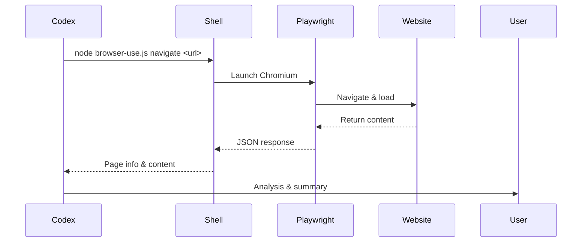
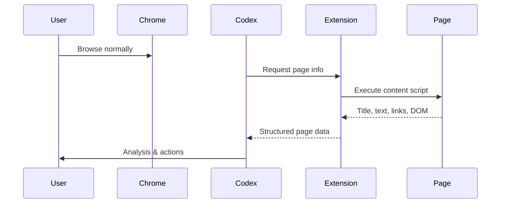

# Codex Browser Use

> 为 Codex 提供完整的浏览器自动化和计算机使用能力  
> 基于 Playwright 引擎 + Chrome 扩展插件

## 项目结构

```
browser-use/
├── scripts/
│   ├── browser-use.js           # CLI 工具 - 单次浏览器操作
│   ├── browser-use-server.js    # 服务端 - 持久化浏览器会话
│   └── install-extension.ps1    # Chrome 扩展安装脚本
├── chrome-extension/
│   ├── manifest.json            # Chrome 扩展清单 (Manifest V3)
│   ├── background.js            # 扩展后台服务
│   ├── content.js               # 页面内容脚本
│   ├── popup.html               # 扩展弹出界面
│   ├── popup.js                 # 弹出界面逻辑
│   └── icons/                   # 扩展图标
├── skills/
│   └── SKILL.md                 # Codex 技能文件
├── bin/
│   └── browser-use.bat          # Windows 命令行包装
└── package.json
```

## 快速开始

### 1. 安装依赖（已完成）
```powershell
cd browser-use
npm install
npx playwright install chromium
```

### 2. 使用浏览器自动化

**导航到网页：**
```powershell
node scripts/browser-use.js navigate https://baidu.com
```

**下载页面内容：**
```powershell
node scripts/browser-use.js download https://example.com
```

**获取可见文本：**
```powershell
node scripts/browser-use.js text          # 整个页面
node scripts/browser-use.js text h1       # 指定选择器
```

**截图：**
```powershell
node scripts/browser-use.js screenshot
```

**查看所有链接：**
```powershell
node scripts/browser-use.js links
```

### 3. 持久化服务器模式

**启动浏览器服务（后台运行）：**
```powershell
node scripts/browser-use.js start
```

**启动并显示浏览器窗口：**
```powershell
node scripts/browser-use.js start --headed
```

**停止服务：**
```powershell
node scripts/browser-use.js stop
```

**查看状态：**
```powershell
node scripts/browser-use.js status
```

## Chrome 扩展安装

### 安装步骤：
1. 打开 Chrome 浏览器，访问 `chrome://extensions/`
2. 开启右上角的 **开发者模式**
3. 点击 **加载已解压的扩展程序**
4. 选择 `browser-use/chrome-extension` 文件夹
5. 扩展图标出现在工具栏（快捷键: `Ctrl+Shift+B`）

### 扩展功能：
- 📄 **获取页面内容** - 提取当前页面的标题、文本、HTML
- 📝 **获取可见文本** - 提取页面上所有可见文字
- 🔗 **获取链接** - 提取页面上所有链接
- 🎯 **高亮元素** - 高亮页面上的指定元素
- 🤖 **询问 Codex** - 将页面上下文复制给 Codex 分析

## 能力清单

| 能力 | 说明 | 使用方式 |
|------|------|----------|
| navigate | 浏览网页 | CLI / 扩展 |
| get_page_content | 获取页面 HTML | CLI / 扩展 |
| get_visible_text | 提取可见文本 | CLI / 扩展 |
| click_element | 点击元素 | 扩展 |
| type_text | 填写输入框 | 扩展 |
| execute_javascript | 执行 JS | 扩展 |
| take_screenshot | 截图 | CLI |
| extract_links | 提取链接 | CLI / 扩展 |
| scroll_page | 滚动页面 | CLI / 扩展 |

## 工作流程

### 方案 A：CLI 模式


### 方案 B：Chrome 扩展模式


## 技术说明

- 基于 Playwright 1.60（Chromium 148）
- Chrome 扩展使用 Manifest V3
- 支持 headless（无头）和 headed（可见窗口）模式
- 截图保存在 `screenshots/` 目录
- 浏览器状态保存在 `browser-state.json`
